# Flutter Mana

[](https://pub.dev/packages/flutter_mana)
[](https://pub.dev/packages/flutter_mana_kits)


Flutter 应用内调试工具平台.
an in-app debug kits platform for Flutter.

> 因为flutter_ume不维护，项目因此而生，`mana`的名字来自于一部国漫《灵笼》中的玛娜设定，强烈推荐！


**尽量在开发环境使用，部分插件只在开发环境才能生效！！！**

## 环境

**不考虑兼容低版本**

```yaml
dart: ">=3.14.0 <4.0.0"
flutter: ">=3.50.0"
```

## 使用

- 安装

```shell
flutter pub add flutter_mana
flutter pub add flutter_mana_kits
```

- 代码中使用

```dart
import 'package:flutter/material.dart';
import 'package:flutter_mana/flutter_mana.dart';
import 'package:flutter_mana_kits/flutter_mana_kits.dart';

void main() => runApp(const App());

class App extends StatefulWidget {
  const App({super.key});
  @override
  State<App> createState() => _AppState();
}

class _AppState extends State<App> {
  late final controller = ManaController(plugins: loadAllPlugins());
  late final observer = ManaNavigatorObserver(controller);

  @override
  void dispose() {
    observer.dispose();
    controller.dispose();
    super.dispose();
  }

  @override
  Widget build(BuildContext context) => MaterialApp(
    navigatorObservers: [observer],
    home: const Text('Example'),
    builder: (context, child) => ManaWidget.builder(
      controller: controller,
      child: child!,
    ),
  );
}
```

## 插件&使用

```
✅ - 支持
❌ - 不支持
⭕️ - 部分支持
```

| 插件&文档                                                                                                                                                            | android | ios | macos | windows | linux | web | debug | release |
|:-----------------------------------------------------------------------------------------------------------------------------------------------------------------|:-------:|:---:|:-----:|:-------:|:-----:|:---:|:-----:|:-------:|
| [标尺 - AlignRuler](https://github.com/lhlyu/flutter_mana/tree/master/packages/kits/lib/src/plugins/mana_align_ruler)                                              |    ✅    |  ✅  |   ✅   |    ✅    |   ✅   |  ✅  |   ✅   |    ✅    |
| [日志查看器 - LogViewer](https://github.com/lhlyu/flutter_mana/tree/master/packages/kits/lib/src/plugins/mana_logger)                                                 |    ✅    |  ✅  |   ✅   |    ✅    |   ✅   |  ✅  |   ✅   |   ⭕️    |
| [设备信息 - DeviceInfo](https://github.com/lhlyu/flutter_mana/tree/master/packages/kits/lib/src/plugins/mana_device_info)                                            |    ✅    |  ✅  |   ✅   |    ✅    |   ✅   |  ✅  |   ✅   |    ✅    |
| [颜色吸管 - ColorSucker](https://github.com/lhlyu/flutter_mana/tree/master/packages/kits/lib/src/plugins/mana_color_sucker)                                          |    ✅    |  ✅  |   ✅   |    ✅    |   ✅   |  ✅  |   ✅   |    ✅    |
| [Dio网络检查器 - DioInspector](https://github.com/lhlyu/flutter_mana/tree/master/packages/kits/lib/src/plugins/mana_dio_inspector)                                    |    ✅    |  ✅  |   ✅   |    ✅    |   ✅   |  ✅  |   ✅   |    ✅    |
| [Widget详情 - WidgetInfoInspector](https://github.com/lhlyu/flutter_mana/tree/master/packages/kits/lib/src/plugins/mana_widget_info_inspector)                     |    ✅    |  ✅  |   ✅   |    ✅    |   ✅   |  ✅  |   ✅   |    ❌    |
| [帧率监控 - FpsMonitor](https://github.com/lhlyu/flutter_mana/tree/master/packages/kits/lib/src/plugins/mana_fps_monitor)                                            |    ✅    |  ✅  |   ✅   |    ✅    |   ✅   |  ❌  |   ✅   |    ✅    |
| [SharedPreferences查看器 - SharedPreferencesViewer](https://github.com/lhlyu/flutter_mana/tree/master/packages/kits/lib/src/plugins/mana_shared_preferences_viewer) |    ✅    |  ✅  |   ✅   |    ✅    |   ✅   |  ✅  |   ✅   |    ✅    |
| [显示代码 - ShowCode](https://github.com/lhlyu/flutter_mana/tree/master/packages/kits/lib/src/plugins/mana_show_code)                                                |    ✅    |  ✅  |   ✅   |    ✅    |   ✅   |  ❌  |   ✅   |    ❌    |
| [内存信息 - MemoryInfo](https://github.com/lhlyu/flutter_mana/tree/master/packages/kits/lib/src/plugins/mana_memory_info)                                            |    ✅    |  ✅  |   ✅   |    ✅    |   ✅   |  ❌  |   ✅   |    ❌    |
| [包信息 - PackageInfo](https://github.com/lhlyu/flutter_mana/tree/master/packages/kits/lib/src/plugins/mana_package_info)                                           |    ✅    |  ✅  |   ✅   |    ✅    |   ✅   |  ✅  |   ✅   |    ✅    |
| [许可 - License](https://github.com/lhlyu/flutter_mana/tree/master/packages/kits/lib/src/plugins/mana_license)                                                     |    ✅    |  ✅  |   ✅   |    ✅    |   ✅   |  ✅  |   ✅   |    ✅    |
| [网格 - Grid](https://github.com/lhlyu/flutter_mana/tree/master/packages/kits/lib/src/plugins/mana_grid)                                                           |    ✅    |  ✅  |   ✅   |    ✅    |   ✅   |  ✅  |   ✅   |    ✅    |
| [视觉辅助 - VisualHelper](https://github.com/lhlyu/flutter_mana/tree/master/packages/kits/lib/src/plugins/mana_visual_helper)                                        |    ✅    |  ✅  |   ✅   |    ✅    |   ✅   |  ✅  |   ✅   |   ⭕️    |
| [触摸指示器 - TouchIndicator](https://github.com/lhlyu/flutter_mana/tree/master/packages/kits/lib/src/plugins/mana_touch_indicator)                                   |    ✅    |  ✅  |   ✅   |    ✅    |   ✅   |  ✅  |   ✅   |    ✅    |
| [屏幕信息 - ScreenInfo](https://github.com/lhlyu/flutter_mana/tree/master/packages/kits/lib/src/plugins/mana_screen_info)                                            |    ✅    |  ✅  |   ✅   |    ✅    |   ✅   |  ✅  |   ✅   |    ✅    |

## 预览图

| 插件                                                                                                                        |                                                                                                                                                    |                                                                                                                                    |
|---------------------------------------------------------------------------------------------------------------------------|----------------------------------------------------------------------------------------------------------------------------------------------------|------------------------------------------------------------------------------------------------------------------------------------|
| 面板                                                                                                                        | 日志查看器                                                                                                                                              | 设备信息                                                                                                                               |
| 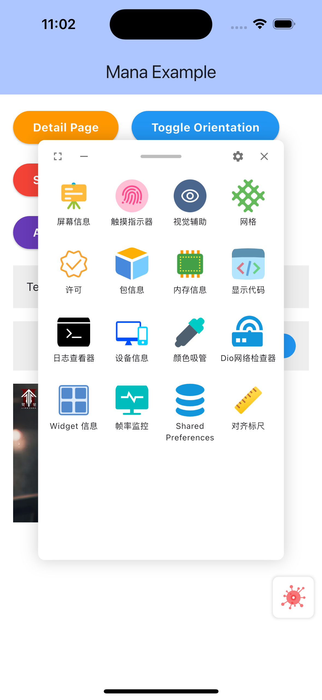            | 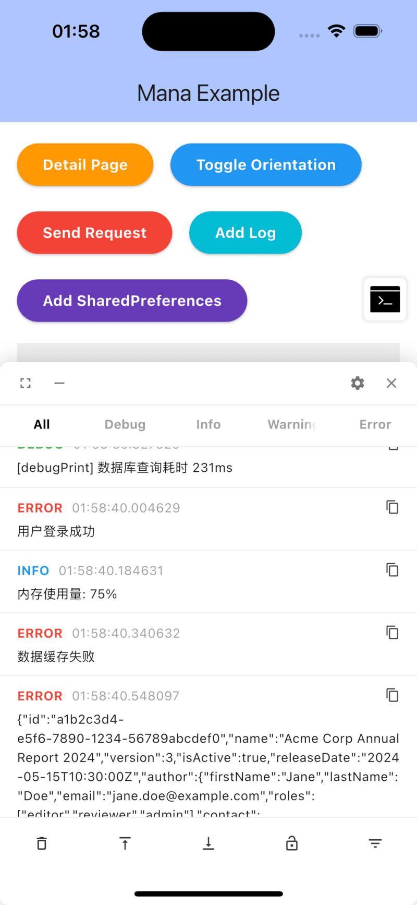                               | 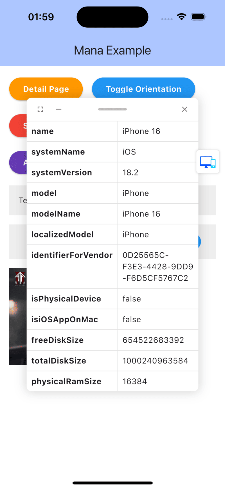               |
| 颜色吸管                                                                                                                      | Dio网络检查器                                                                                                                                           | Widget详情                                                                                                                           |
| 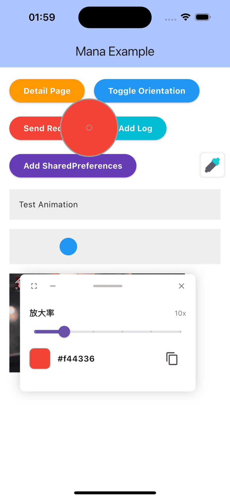     | 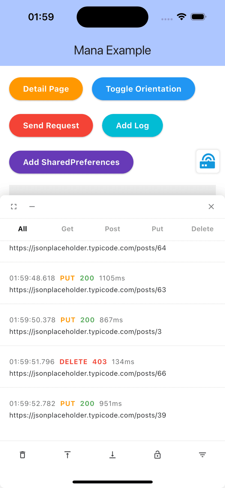                         | 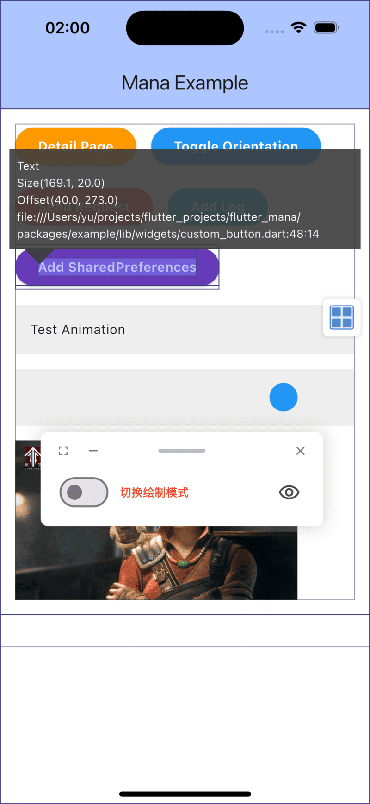 |
| 帧率监控                                                                                                                      | SharedPreferences查看器                                                                                                                               | 标尺                                                                                                                                 |
| 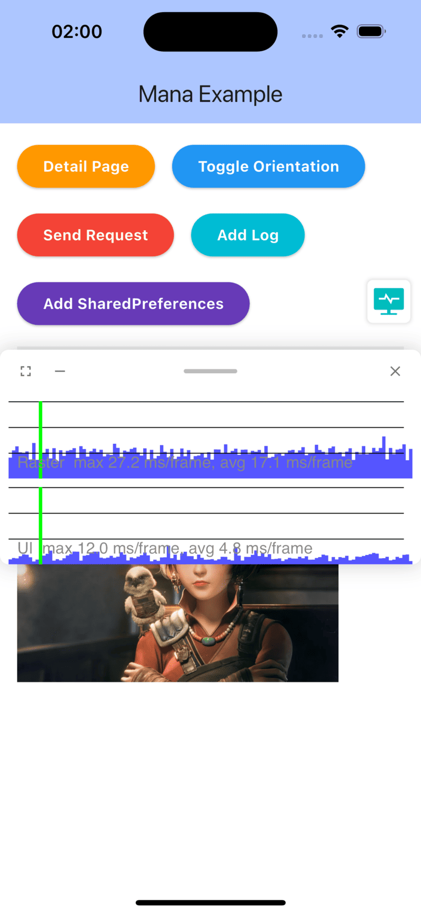      | 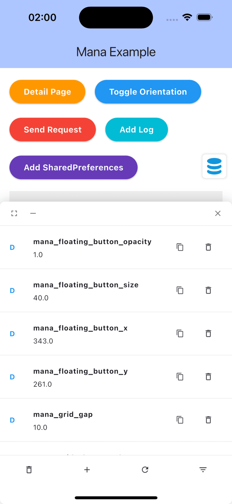 | 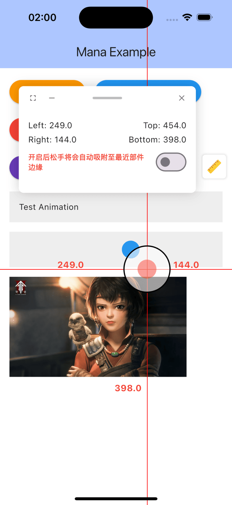                 |
| 显示代码                                                                                                                      | 内存信息                                                                                                                                               | 包信息                                                                                                                                |
| 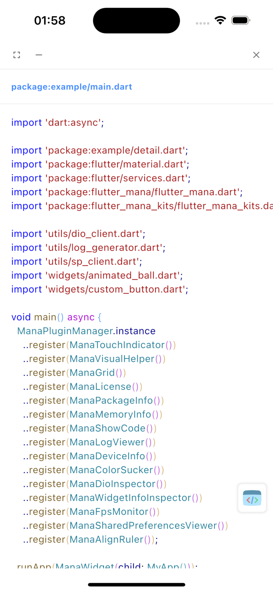        | 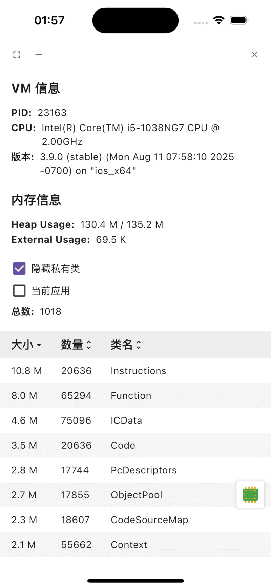                               | 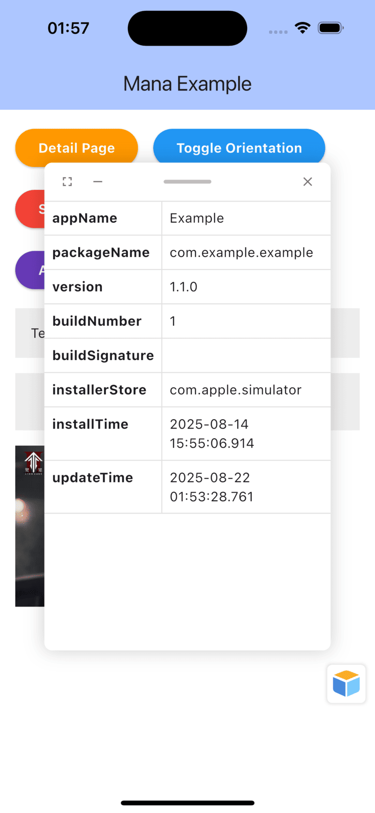               |
| 许可                                                                                                                        | 网格                                                                                                                                                 | 视觉辅助                                                                                                                               |
| 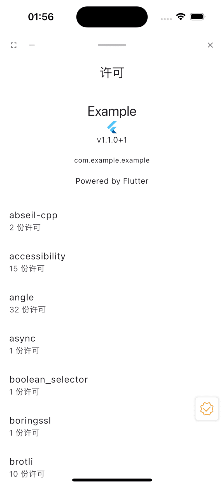            | 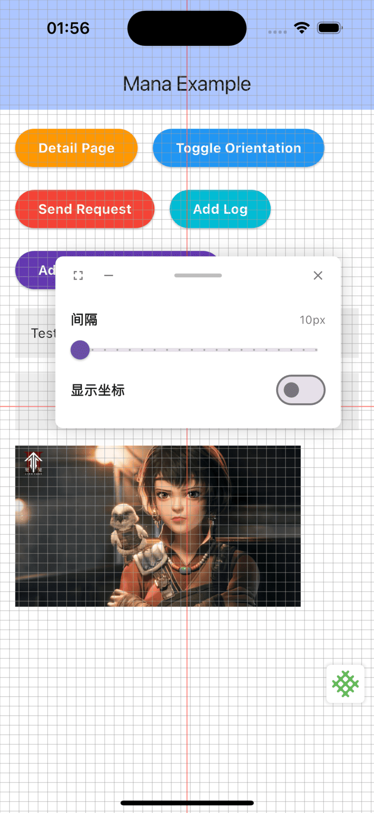                                        | 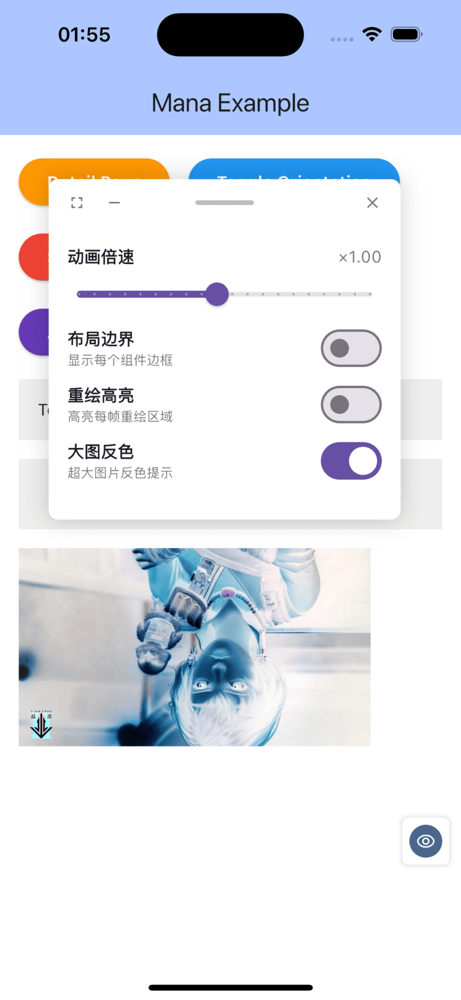             |
| 触摸指示器                                                                                                                     | 屏幕信息                                                                                                                                               |                                                                                                                                    |
| 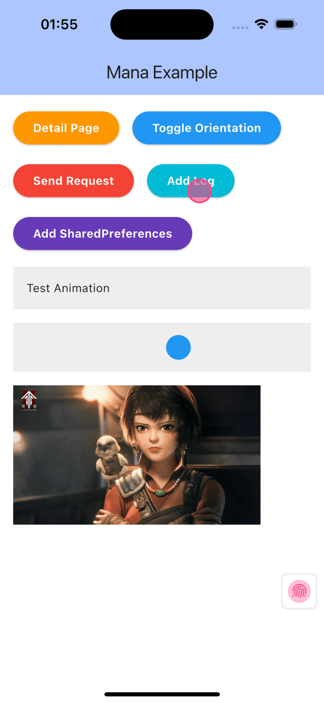 | 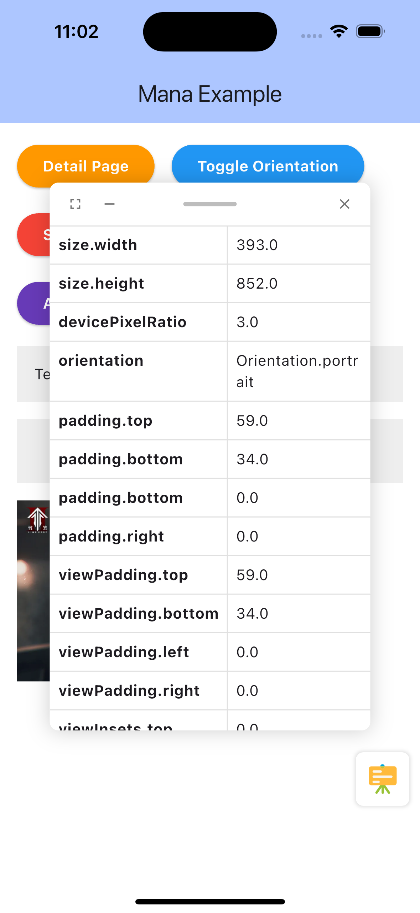                               |                                                                                                                                    |

## 插件开发

- [参考](https://github.com/lhlyu/flutter_mana/tree/master/packages/kits/lib/src/plugins/demo)

- 安装依赖

```shell
flutter pub add flutter_mana
```

- 实现插件

```dart
import 'package:flutter/widgets.dart';
import 'package:flutter_mana/flutter_mana.dart';

class MyPlugin extends ManaPluggable {
  @override
  String get name => 'my_tool';

  @override
  String getLocalizedDisplayName(Locale locale) =>
      locale.languageCode == 'zh' ? '自定义工具' : 'My Tool';

  @override
  ImageProvider get iconImageProvider =>
      const AssetImage('assets/my_plugin.png');

  @override
  Widget buildWidget(BuildContext context) => ManaFloatingWindow(
    name: name,
    content: const Center(child: Text('My Tool')),
  );
}

void main() => runApp(ManaWidget(
  plugins: [MyPlugin()],
  child: const Center(child: Text('Example')),
));
```

图片可使用 `AssetImage`、`NetworkImage` 或 `MemoryImage`，不需要转换 base64。SVG、自绘或其他 Widget 图标覆盖 `buildIcon`。例如添加插件自己的 `flutter_svg` 依赖、引入 `package:flutter_svg/flutter_svg.dart` 后：

```dart
@override
Widget buildIcon(BuildContext context, {double size = 40}) =>
    SvgPicture.asset('assets/my_plugin.svg', width: size, height: size);
```

图标会同时用于插件面板和悬浮入口，`size` 由宿主传入。不设置图标时使用 Mana 默认图标；内置 kits 的 SVG 样式不限制第三方插件。

## 参考

- [flutter_ume](https://github.com/bytedance/flutter_ume)
- [inspector](https://github.com/kekland/inspector)
- [logarte](https://github.com/kamranbekirovyz/logarte)
- [plus_plugins](https://github.com/fluttercommunity/plus_plugins)
- [free api](https://jsonplaceholder.typicode.com/)
- [info_popup](https://pub.dev/packages/info_popup)
- [do kit](https://github.com/didi/DoKit)
- [fps monitor](https://github.com/Nayuta403/fps_monitor)
- [code highlight](https://github.com/toly1994328/FlutterUnit/blob/master/modules/basic_system/toly_ui/lib/code/code_widget.dart)
- [vConsole](https://wechatfe.github.io/vconsole/demo.html)
- [debug friend](https://pub.dev/packages/debug_friend)
- [widget with codeview](https://github.com/X-Wei/widget_with_codeview)
- [flutter：全局 context 在 navigator 与 overlay 中的运用](https://juejin.cn/post/7200191765516615737)
- [fconsole](https://github.com/fluttercandies/fconsole/blob/8b32f57399396ecb7f5792c0e6c86df3e991d002/lib/src/widget/console.dart#L117)
- [内存泄漏检测原理](https://juejin.cn/post/6922625442323103758)
- [内存泄漏检测库](https://github.com/liujiakuoyx/leak_detector)
- [卡顿检测](https://juejin.cn/post/7434899217804902427)