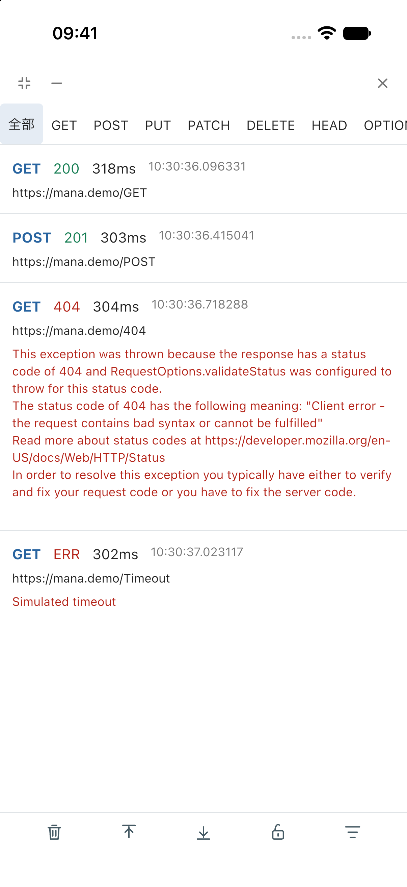

# Flutter Mana

[](https://pub.dev/packages/flutter_mana)
[](https://pub.dev/packages/flutter_mana_kits)


Flutter 应用内调试平台 / In-app debugging tools for Flutter.

## 环境要求

| 环境 | 最低版本 |
| --- | --- |
| Flutter | **3.50.0** |
| Dart | **3.14.0** |

**不兼容更低版本。建议仅在开发 / 内部演示环境开启，不要向生产用户暴露调试数据。**

支持 Android、iOS、macOS、Windows、Linux 和 Web，部分工具有限制：

- **完整体验需原生 Debug 模式**：内存信息和源代码浏览依赖 VM Service，组件检查仅支持 Debug。
- **Web 不支持帧率监控、内存信息和源代码浏览**。完整支持情况见 [平台支持矩阵](docs/kits.md)。

## 安装

```bash
flutter pub add flutter_mana
flutter pub add flutter_mana_kits
```

- **flutter_mana**：基于基础 Widgets 的插件平台，提供悬浮入口、浮窗和生命周期管理，不依赖 Material / Cupertino。
- **flutter_mana_kits**：16 个可选工具，覆盖网络、日志、存储、设备、布局与运行时诊断。

通过 `ManaWidget.builder` 接入已有应用；网络与日志工具须共享业务采集器。详见 [使用指南](docs/getting-started.md)，或运行 [example](packages/example/README.md) 体验。

## 文档

| 文档 | 内容 |
| --- | --- |
| [使用指南](docs/getting-started.md) | 应用接入、返回行为、按需加载、网络 / 日志采集与资源释放。 |
| [公开 API 速查](docs/api.md) | 调试层显隐、插件 / 窗口控制、状态、生命周期与采集器方法。 |
| [项目架构](docs/architecture.md) | 包依赖、核心分层、状态与数据流、生命周期和资源归属。 |
| [自定义插件](docs/custom-plugins.md) | 最小示例、图标、展示方式、生命周期与插件生成。 |
| [内置插件与平台支持](docs/kits.md) | 全部 16 个工具的使用说明、支持矩阵及限制。 |
| [完整预览](docs/previews.md) | 全部工具和面板的最新截图。 |
| [重新截图](docs/screenshots.md) | 原生截图流程、采集脚本与文件命名约定。 |
| [项目缘起与参考](docs/references.md) | 项目背景、参考项目及文章。 |

## 开发与验证

在仓库根目录运行：

```bash
dart scripts/check.dart        # 格式、静态分析、发布脚本与三个包的全部测试
dart scripts/check.dart --web  # 同时验证示例应用的 Web Release 构建
```

脚本会从各包目录运行测试，确保示例的 shader 等资源正确加载。主分支、发布分支和 Pull Request 使用相同入口执行 CI 检查。

## 预览图

当前 example 的原生 Debug 截图（2026-11-15 更新），已同步紧凑分段标签栏与最新工具界面。

| 面板 | 网络检查 | 内存信息 |
|:---:|:---:|:---:|
|  |  |  |

[查看全部工具截图 →](docs/previews.md)

## 开源许可

[MIT](LICENSE)
