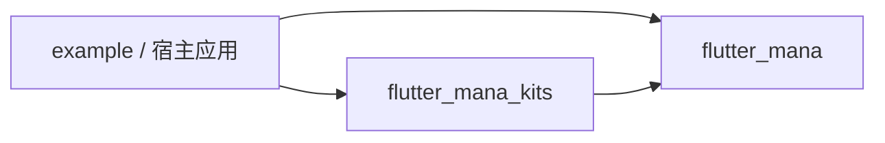

# 项目架构

[文档目录](README.md) · [使用指南](getting-started.md) · [自定义插件](custom-plugins.md)

Flutter Mana 分为**核心平台、内置工具和示例应用**。核心负责运行时与展示机制，工具负责采集和诊断，业务通过实例注入完成组装。

## 包与依赖方向

仓库使用 Dart workspace 管理三个包：



| 目录 | 职责 |
| --- | --- |
| `packages/core` | 插件协议、控制器、存储、悬浮界面及可选诊断能力。 |
| `packages/kits` | 16 个内置工具、网络 / 日志采集器、通用工具布局和图标。 |
| `packages/example` | 组装控制器与共享采集器，提供演示数据和交互场景。 |
| `scripts` | 生成工具、采集截图，不参与正常应用运行。 |

**core 不依赖 kits**，第三方插件只需实现 `ManaPluggable`。core 与 kits 的界面基于基础 Widgets，不依赖 Material / Cupertino；示例应用自行选择设计系统。

## 核心分层

| 模块 | 关键类型 | 职责 |
| --- | --- | --- |
| `runtime` | `ManaController`、`ManaState` | 统一命令入口，维护当前插件、窗口模式、调试层 / 面板显隐和入口设置。 |
| `runtime` | `ManaPluginManager`、`ManaPluggable` | 插件注册、支持检查、初始化、失败隔离和生命周期。 |
| `runtime` | `ManaWidget`、`ManaScope` | 挂载宿主，向调试层提供控制器并订阅状态。 |
| `storage` | `ManaPreferences`、`ManaStore` | 抽象设置读写，默认适配 SharedPreferences。 |
| `widgets` | `ManaOverlay`、`ManaFloatingWindow` | 根据运行时状态展示入口、面板和插件浮窗。 |
| `diagnostics` | `VmInspector`、`HitTestUtils` | VM Service 访问、组件命中与诊断。 |

公开入口分为 [flutter_mana.dart](../packages/core/lib/flutter_mana.dart)（运行时与浮窗）、[flutter_mana_widgets.dart](../packages/core/lib/flutter_mana_widgets.dart)（中立 UI 组件）和 [flutter_mana_diagnostics.dart](../packages/core/lib/flutter_mana_diagnostics.dart)（可选诊断）。第三方插件不应依赖 `src/` 内部实现。

## 宿主与界面树

[接入宿主](../packages/core/lib/src/runtime/mana_widget.dart) 有两种方式：`ManaWidget.builder` 复用应用环境；独立的 `ManaWidget` 自建 WidgetsApp。

```text
ManaWidget
└── ManaScope（提供 ManaController）
    └── Stack
        ├── RepaintBoundary（业务界面，rootKey）
        └── 调试 Overlay
            └── ManaOverlay
                ├── 当前插件的 Widget
                ├── 插件面板（按需显示）
                └── 悬浮入口（按需显示）
```

业务界面与调试层分开，取色截图和组件命中可通过 `rootKey` 定位业务区域。`overlayBuilder` 可为调试层补充 Theme / Provider；返回行为通过 Navigator observer 或 Router dispatcher 接入。

[窗口控制器](../packages/core/lib/src/widgets/floating_window/controller.dart) 管理位置、尺寸及设置页显隐；当前插件和插件窗口模式仍由运行时管理，避免窗口自行切换会话。

## 状态与插件生命周期

[控制器](../packages/core/lib/src/runtime/mana_controller.dart) 通过命令更新不可变的 `ManaState`，再用 `ChangeNotifier` 通知界面。`ManaScope.of` 订阅变化，`ManaScope.read` 只读取实例。插件内部的搜索词、选中项等局部状态留在各自 Widget 中，不放入全局运行时状态。

### 启动

1. 宿主挂载控制器，读取设置；一个控制器只能挂到一个宿主。
2. 设置加载完成后开放调试界面，同时后台并行初始化插件，不让慢插件阻塞整个面板。
3. 注册表分别记录 `pending`、`initializing`、`ready`、`unsupported` 或 `failed`。单个插件初始化失败不影响其他插件，可单独重试。

### 激活、切换与关闭

打开新工具的典型流程：

```text
activatePlugin(id)
  → 确认插件可用并等待初始化
  → 停止旧插件：deactivate()
  → 启动新插件：onTrigger()
  → 更新 activePluginId，界面构建 buildWidget()
```

- 同一控制器最多有一个活动插件，插件面板可独立打开。
- 激活与关闭操作串行衔接，并用代次标识取消过期请求，防止异步操作覆盖新状态。
- **最小化不等于关闭**：最小化不结束插件会话，默认保留窗口内容状态并暂停其动画、键盘焦点及列表刷新；自定义覆盖层可继续显示。关闭或切换时执行 `deactivate()`。
- `action` 插件执行后即结束，不保留活动界面；最终注销或关闭运行时时执行 `dispose()`。

注册表通过只读的 `ManaPluginRegistry` 暴露给调用方；注册、激活、重试和注销统一走控制器。具体实现见 [插件管理器](../packages/core/lib/src/runtime/mana_plugin_manager.dart)。

## 内置工具与数据流

[loadAllPlugins()](../packages/kits/lib/flutter_mana_kits.dart) 每次创建一组新插件，不使用全局插件单例。内部的 `BuiltinKit` 统一名称、双语标题和 SVG 图标；`KitWindow` 处理窗口适配，`KitScaffold` 组织搜索、内容和操作区。

网络与日志的数据流不经过 `ManaState`：

```text
业务 Dio    → ManaDioCollector ─┐
                              ├→ 采集器通知 → 工具列表 / 筛选 / 详情
业务 Logger → ManaLogCollector ┘
```

业务和工具必须使用**同一采集器实例**。采集器基于 [BoundedCollector](../packages/kits/lib/src/data/bounded_collector.dart)，默认保留 1000 条记录，超出容量淘汰最早数据；数据未变化时复用只读列表快照。隐藏工具时继续采集，列表恢复显示时读取最新数据；网络详情返回列表时保留筛选和滚动位置。

设备、包、偏好等工具直接访问对应平台服务；内存和源码通过 VM Service 读取当前应用。共享实例的组装与清理可参考 [DemoSession](../packages/example/lib/demo_session.dart)。

## 存储、诊断与资源归属

`ManaPreferences` 同时提供入口设置和插件配置的读写。默认的 `ManaStore` 支持命名空间隔离；多运行时如需隔离持久化配置，应使用不同命名空间，测试可注入 `MemoryManaPreferences`。这与偏好设置工具查看的业务 SharedPreferences 数据不是同一个职责。

VM 诊断通过条件导出区分原生实现与 Web 占位实现；导入接口不代表平台可用，工具仍需检查 `isSupported`。`VmInspector` 按实例管理连接，具体限制见 [平台支持](kits.md)。

| 资源 | 释放方 |
| --- | --- |
| `ManaWidget` 内部创建的控制器 | `ManaWidget`。 |
| 外部传入的控制器、Navigator observer | 调用方；需要等待清理时使用 `await controller.close()`。 |
| 已注册插件、控制器使用的 `ManaPreferences` | 控制器。 |
| 插件自行创建的采集器或诊断服务 | 插件及其内部组件。 |
| 外部注入的采集器、业务 Dio / Logger | 业务宿主。 |

实例隔离不意味着完全没有全局状态：Flutter 的调试开关和 `debugPrint` 本身是进程级能力。[DebugSession](../packages/kits/lib/src/diagnostics/debug_session.dart) 与日志捕获使用可释放的租约 / 订阅，关闭时恢复原设置，并保留其他使用者的需求。

## 代码阅读与测试

建议按“宿主 → 控制器 → 插件管理器 → 具体工具”阅读，测试按同样的边界组织：

- [core/test](../packages/core/test)：运行时、存储、宿主集成、返回行为及诊断。
- [kits/test](../packages/kits/test)：数据采集、覆盖层、偏好编辑、VM 界面、响应式布局与生成器。
- [example/test](../packages/example/test)：共享数据、交互、语言 / 主题切换和资源释放。

接入步骤见 [使用指南](getting-started.md)，扩展协议见 [自定义插件](custom-plugins.md)。
