# 完整预览

[文档目录](README.md) · [项目首页](../README.md)

全部 16 个工具及面板截图：**2026-11-15 · iPhone 17 模拟器 · 原生 Debug · 中文浅色 · 1206 × 2622 px**。

本页截图已按当前版本重新采集，日志查看器与网络检查器展示新版紧凑分段标签栏。

命名与采集流程见 [重新截图](screenshots.md)。

| | | |
|:---:|:---:|:---:|
| **面板** 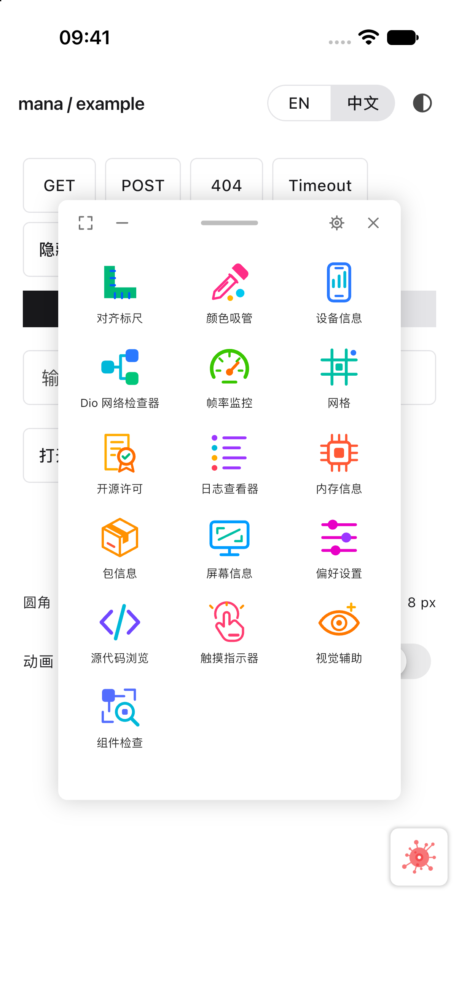 | **日志查看器** 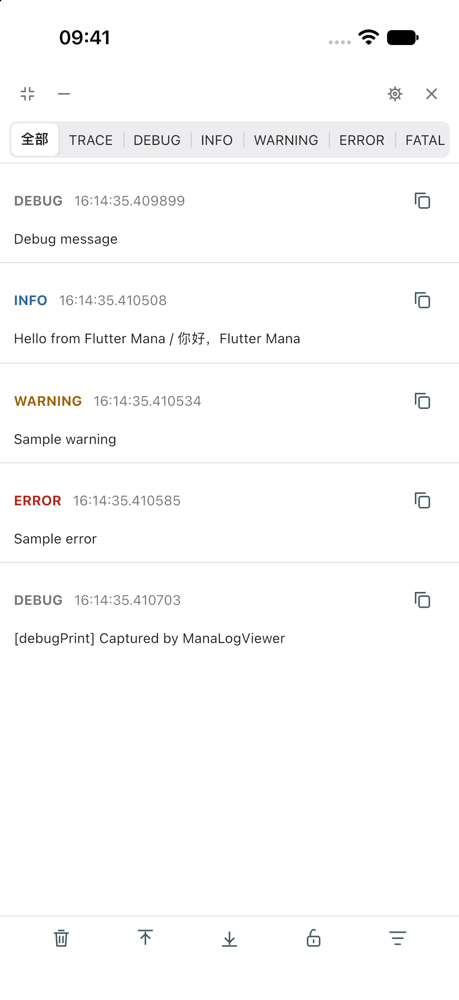 | **设备信息** 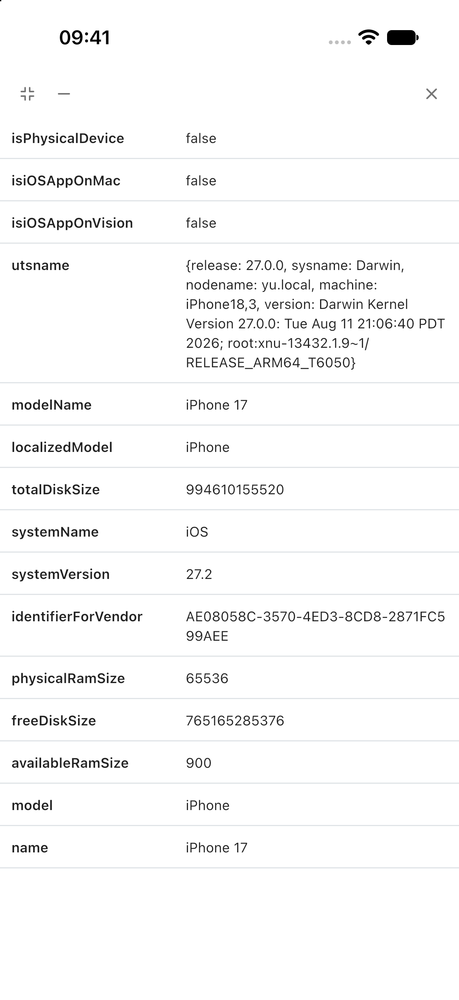 |
| **颜色吸管** 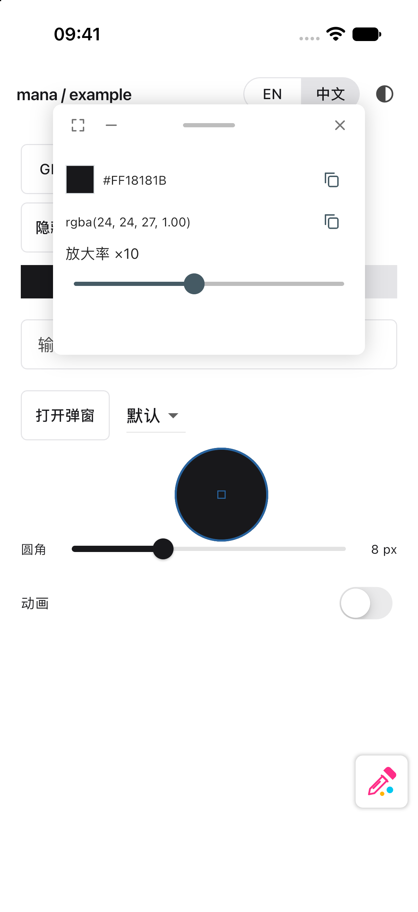 | **Dio 网络检查器** 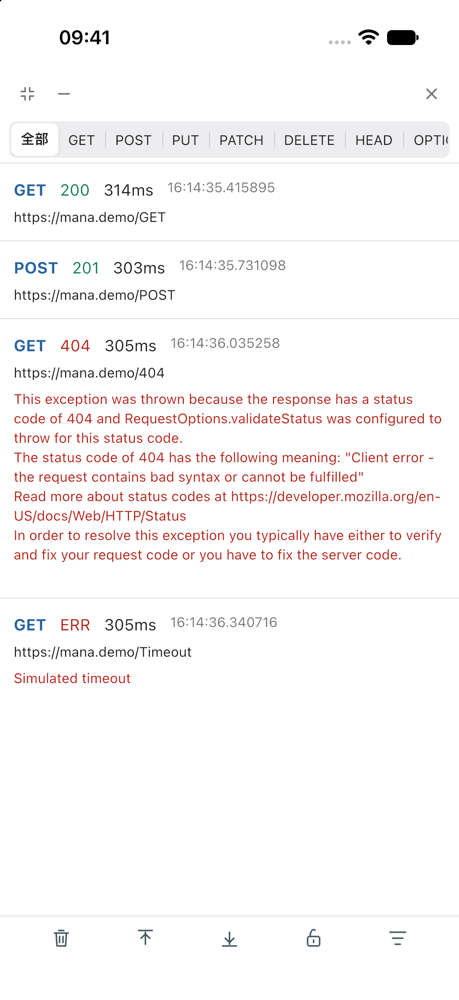 | **组件检查** 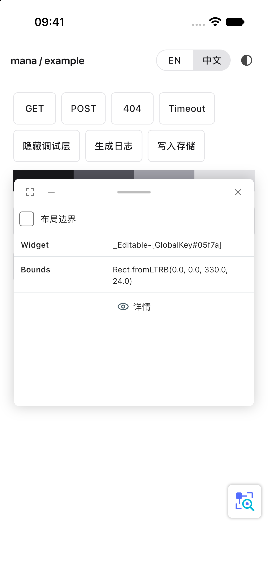 |
| **帧率监控** 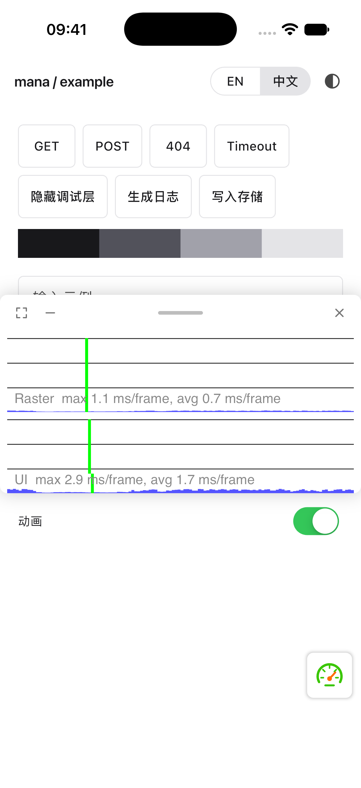 | **偏好设置** 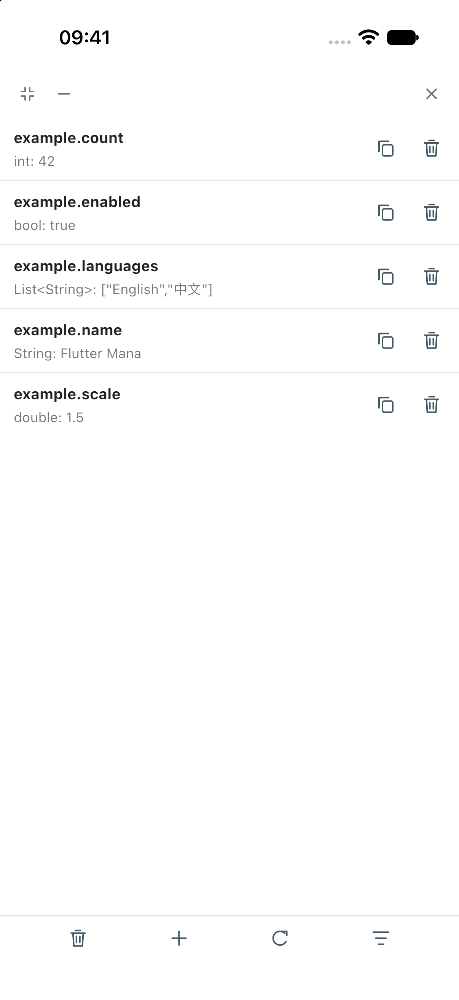 | **对齐标尺** 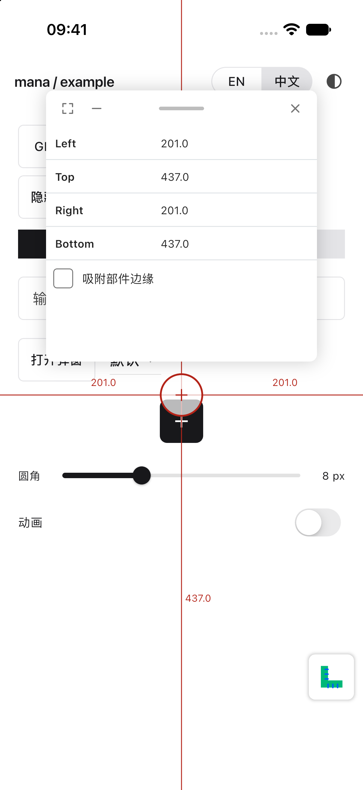 |
| **源代码浏览** 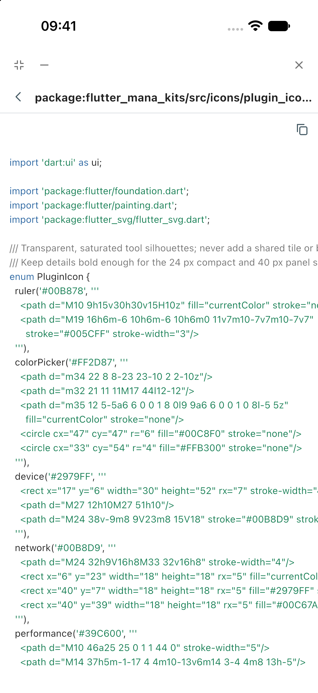 | **内存信息** 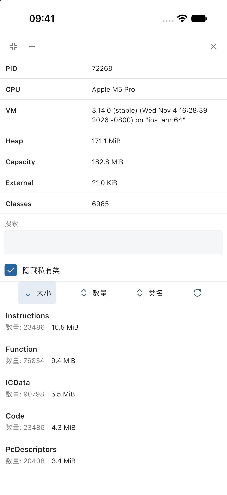 | **包信息** 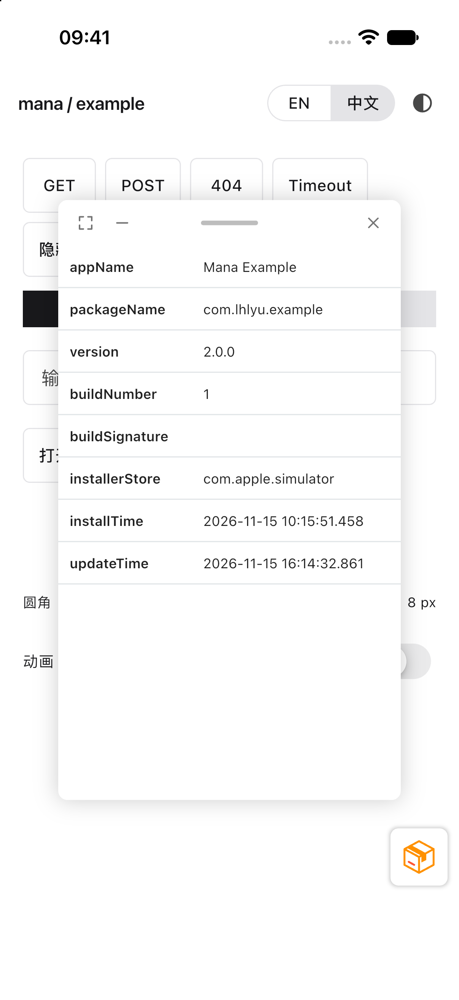 |
| **开源许可** 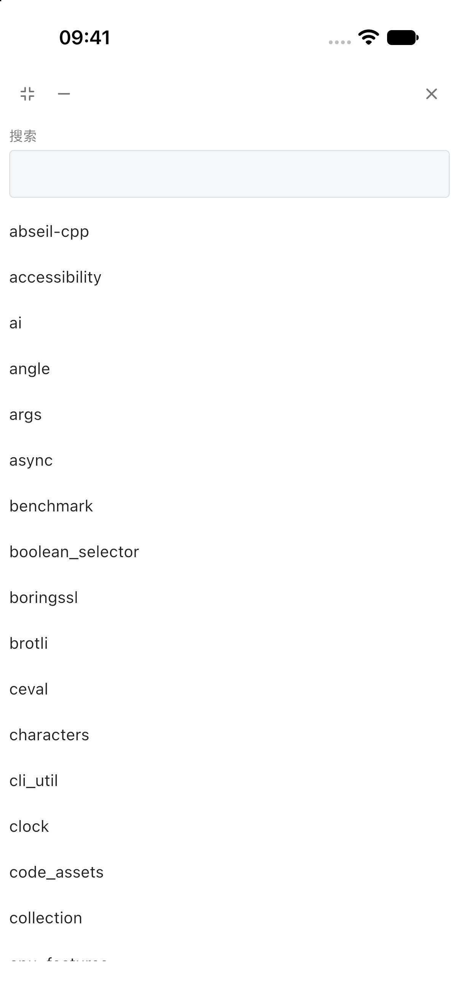 | **网格** 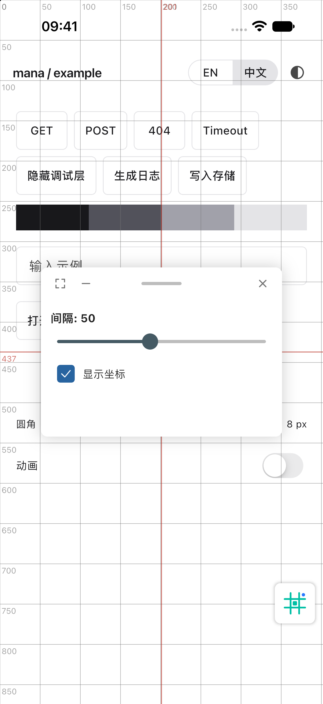 | **视觉辅助** 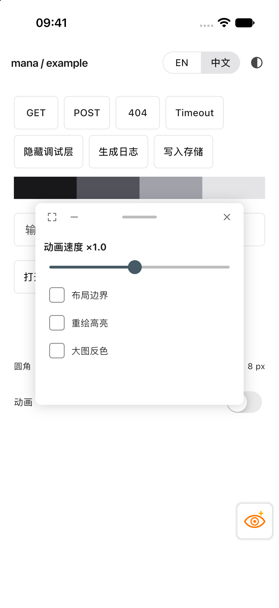 |
| **触摸指示器** 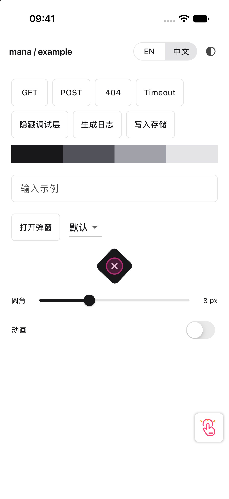 | **屏幕信息** 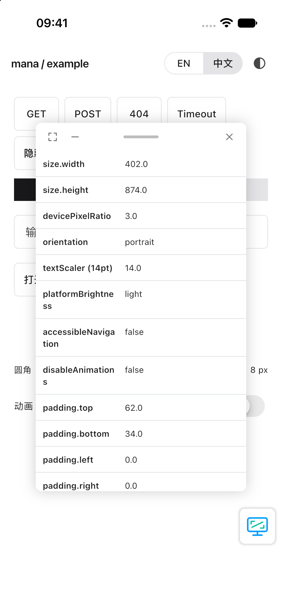 |  |
